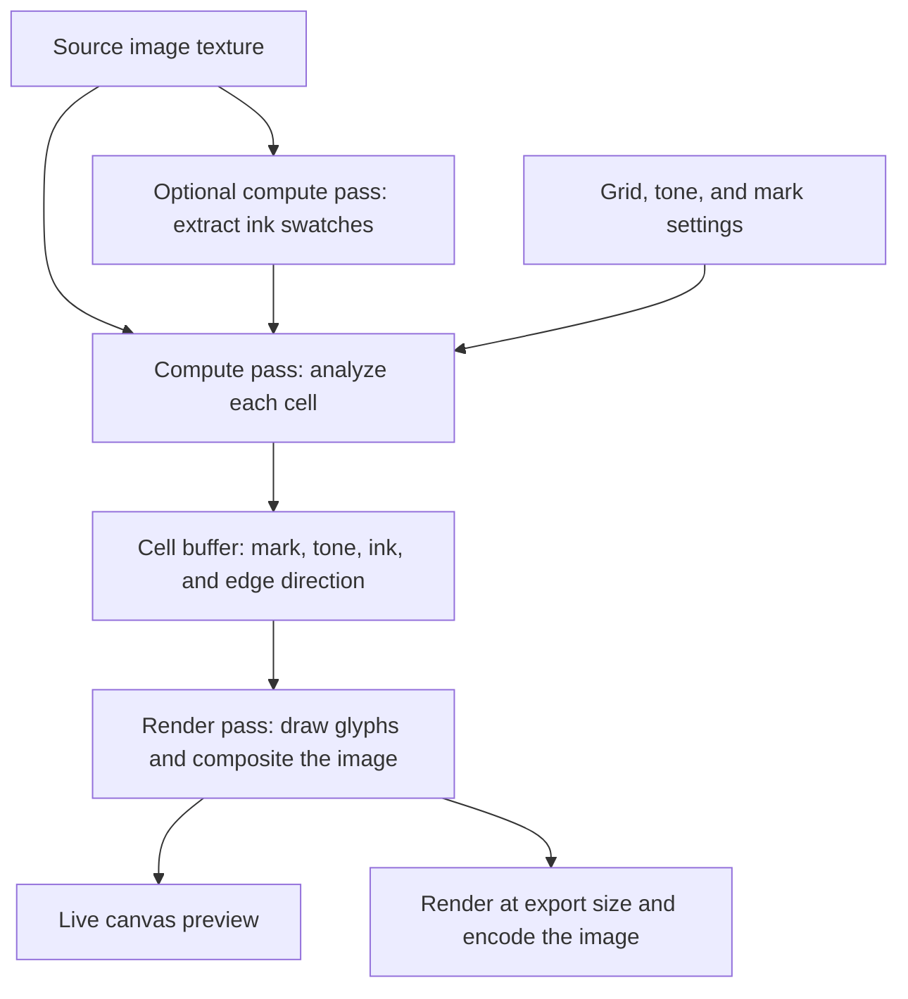
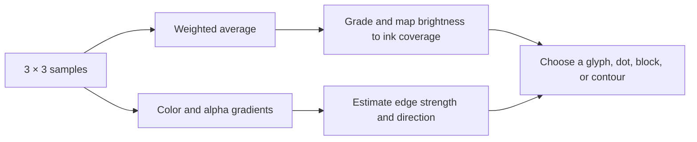

# asciix | WGSL and GLSL

Give a photograph to a handful of punctuation marks and see how well they remember the face. In asciix, a period can be a highlight, a slash can trace a jawline, and a whole crowd of `@`s can stand in for a shadow.

**asciix Studio is a web-based rendering tool.** Open an image in your browser, adjust the ASCII effect, and export the rendered artwork. The studio uses WebGPU to run the full shader and can copy a rendered PNG for pasting into Figma. [Open the web studio](https://soranonvalid.github.io/asciix/)

**The shader is available separately.** The studio and Figma run the WGSL implementation in `main.ts`. The GLSL ES 3.00 version runs the same rendering features in WebGL 2. Download the fragment shader and its JavaScript host together to use the full effect. [GLSL setup and examples](instructions.md#embed-the-glsl-shader)

## Grab the shader

| If you want to… | Open this |
| --- | --- |
| Use the complete effect in Figma’s custom shader editor | [Standalone Figma source · main.ts](main.ts). Copy the whole file, including the property definitions at the end. |
| Study or change the production WebGPU renderer | [Shared WebGPU implementation](main.ts). Find `extractPalette` for ink selection, `userGlyph` for tone mapping, and `fs_main` for the final composite. The GPU code embedded here is **WGSL**. |
| Use the full effect in a WebGL 2 project | [GLSL fragment shader](public/shaders/ascii.frag.glsl) and [JavaScript host](public/shaders/ascii-webgl.js). In the studio header, use **↓ GLSL** and **↓ JS**. |

Both shader versions support editable glyph sets, contours, layered marks, extracted inks, alpha keying, print treatments, captions, and the four motion effects. The [instructions and recipes](instructions.md) give examples for the studio and the GLSL host.

## Make your first print

1. Open the web studio or run it locally with the commands below. The Sally Ride portrait is ready to print. Click **Source** to see the photograph and **Preview** to see the rendered result.
2. Under **Characters**, enter ` .:oO#@` in **Tone characters**. Keep the leading space. That little pocket of nothing gives highlights somewhere to go.
3. Under **Grid & marks**, try **Columns** at **48**, then **120**. Watch what happens to the eyes. Fewer columns make every character carry more of the portrait.
4. Pick **Transparent paper** to see the studio’s checkerboard. In **Export_pipe**, select PNG or WebP and a scale, then click **Export** to save the image with its alpha channel.

## Run the studio

Use Node.js 20.19+ on the 20.x line or 22.12+ and a WebGPU-capable browser with graphics acceleration enabled.

```sh
npm ci
npm run dev
```

Open the local URL printed by Vite. **Open image** loads your own artwork. The bundled icon makes a good silhouette test, and the tone ramp makes changes in glyph density easy to see.

To check the production build locally:

```sh
npm run build
npm run preview
```

Deploy the contents of `dist/` over HTTPS. Relative asset paths support subdirectory hosting.

**Export** supports PNG, WebP, and JPEG at **0.5X**, **1X**, **2X**, **3X**, or **4X**. The studio disables scales that would exceed 4096 pixels on the longest side. JPEG fills transparent areas with white. **Copy** always uses PNG at the selected scale.

Turn on **Animate** and choose Aura, Seed, Heatwave, or Cloth in the **Animation** tab. The studio previews the effect live and can export it as a GIF. [Animation controls and timing](instructions.md#animate-a-print)

## How the ASCII rendering works

The browser uploads the source image as a WebGPU texture. The WGSL shader makes one decision per character cell in a compute pass, then draws those decisions at pixel resolution in a render pass. When palette extraction is enabled, a separate compute pass prepares the swatches first.



### From image samples to marks

For each cell, the shader samples a 3 × 3 neighborhood. The weighted average gives the center sample the most influence. A Sobel-style gradient estimates how strongly the image changes across the cell, and a line perpendicular to that gradient gives the contour direction. Changes in alpha can also identify silhouettes.



| Technique | What it does | Try it in the studio |
| --- | --- | --- |
| Tone mapping | Brightness, contrast, and midtones shape the tone before it maps to the character ramp. Ordered dither varies thresholds on a repeating 4 × 4 grid. | Open the sample ramp and raise **Ordered dither** to see hard tone steps break into a pattern. |
| Directional contours | Strong edges can use marks aligned with the contour, such as a slash on a diagonal. | Open the sample icon and increase **Contour emphasis**. |
| Ink routing | Cells can use sampled image colors or extracted swatches. Named swatches can be assigned by tone and mark type. | Assign a blue swatch to **Mid Contour** and leave the other assignments on **Auto**. |
| Compositing | The drawing pass turns each mark into pixel coverage, then layers ink, paper, and an optional caption. | Enable **Transparent paper** and export PNG or WebP to preserve alpha. |

**Invert image** changes the source tones the shader uses to select marks. **Invert colors** complements the final composite while preserving its alpha and mark pattern. The GLSL renderer uses fragment passes and integer textures for the intermediate data. The same GLSL file also has a small one-pass entry point with the original eight-glyph ramp. [WGSL source](main.ts) · [GLSL source](public/shaders/ascii.frag.glsl) · [One-pass example](instructions.md#one-pass-glsl-entry-point)

## Around the workbench

- [Instructions](instructions.md) · short recipes, Figma setup, and GLSL implementation.
- [Control reference](customization.md) · tone bands, directional glyph slots, palette assignments, and all ten reference treatments.
- [Studio host](src/studio.js) · image upload, WebGPU setup, preview, and image export.
- [GLSL fragment shader](public/shaders/ascii.frag.glsl) · GLSL ES 3.00 with the glyph bitmaps, cell analysis, and compositing code.
- [WebGL 2 host](public/shaders/ascii-webgl.js) · loads images or frames, supplies settings, runs the fragment passes, and reads back extracted colors.

The demo portrait is courtesy of [NASA](https://www.nasa.gov/wp-content/uploads/2022/11/sally_ride.jpg). The full shader uses public-domain VGA bitmaps from [Daniel Hepper’s font8x8](https://github.com/dhepper/font8x8).
